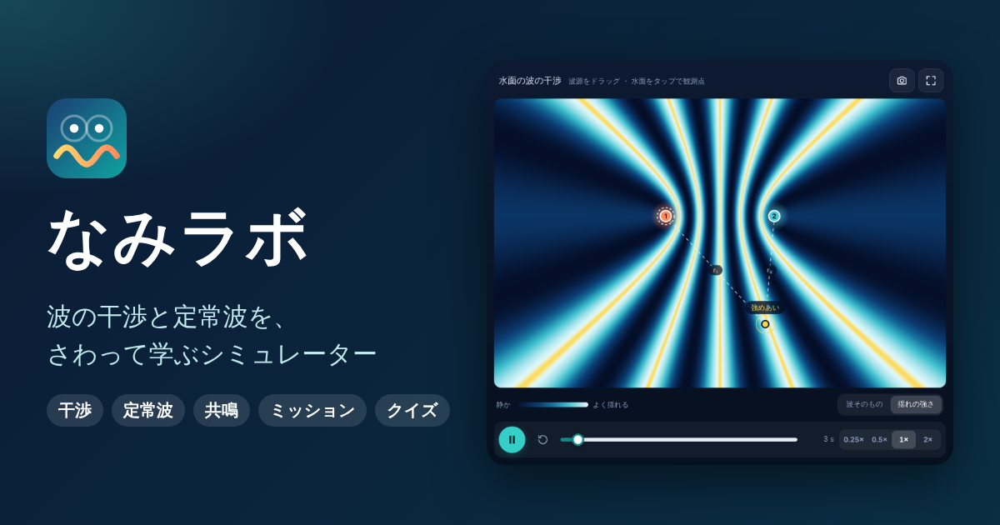

# なみラボ — 波の干渉・定常波シミュレーター

水面の波が重なる「干渉」と、弦にできる「定常波」を、さわって動かしながら学べる高校物理向けの Web アプリです。ミッションとクイズで遊びながら理解を深められます。スマートフォンにもインストールでき（PWA）、一度開けばオフラインでも動きます。



## できること

### 干渉モード（水面の波）

- 波源（1〜4 個）をドラッグして配置、水面をタップすると観測点を設置
- 観測点の距離 r₁・r₂、経路差、強めあい／弱めあいの判定、揺れのグラフをリアルタイム表示
- 「波そのもの」と「揺れの強さ（時間平均の強度）」の 2 つの表示モード
- 強めあう線・弱めあう線・波面（山の位置）のガイド表示。波源の初期位相の差も考慮
- 波長・周波数・振幅・初期位相の調整（全波源で λ と f をそろえるオプションつき）
- プリセット: ふたつの波源 / ひとつの波源 / 逆位相 / 周波数がちがう / 4 波源アレイ
- 配色 4 種類と画質の切り替え

### 定常波モード（弦）

- 固有振動: 両端固定・片側自由・両端自由、基本振動〜6 番目のモード
- 共鳴さがし: 弦をゆらす振動数を変えて共鳴点を探すゲーム。共鳴カーブをタップしてジャンプ、共鳴度メーターつき
- 節・腹のラベル、右向き／左向きの進行波、残像の表示
- 張力・線密度・弦の長さから v = √(T/μ)、f₁ = v/2L などを数値つきで表示
- 実際の振動は速すぎて見えないため、振動数の比を保ったままスロー再生

### 共通

- ミッション 16 個（クリアでお祝い演出、進みぐあいとランクを保存）
- クイズ（各モード 7 問からランダム出題、ベストスコアを保存）
- 「しくみ」タブ: いまの状態の解説、基本の公式、観察のヒント
- 画像保存、全画面表示、再生速度・コマ送り
- 日本語 / English、ライト / ダークテーマ
- キーボードショートカット: Space（再生／一時停止）、R（最初から）、1 / 2（モード切替）、矢印キー（選択中の波源を移動）
- PWA 対応（ホーム画面に追加、オフライン動作）

## 開発

```bash
npm install
npm run dev      # 開発サーバー
npm test         # 単体テスト（Vitest）
npm run lint     # ESLint
npm run build    # 本番ビルド（dist/ に出力）
npm run preview  # ビルド結果の確認
```

### 構成

| パス | 内容 |
| --- | --- |
| `src/lib/waveMath.ts` | 波の物理計算（重ね合わせ、位相差、定常波、強制振動の共鳴応答） |
| `src/lib/clock.ts` | アニメーション用の時計（キャンバスは React を経由せず毎フレーム描画） |
| `src/hooks/` | 各モードの状態管理、localStorage への保存 |
| `src/components/` | 画面部品（キャンバス、操作パネル、ミッション、クイズなど） |
| `src/data/` | プリセット、ミッション、クイズ、UI 文言（日英） |
| `public/` | アイコン、Web App Manifest、Service Worker |

## GitHub Pages への公開

ビルド結果は相対パス（`base: './'`）で出力されるため、`https://<ユーザー名>.github.io/wave-interference-sim/` のようなサブパスでもそのまま動きます。

`.github/workflows/deploy.yml` は **`main` ブランチへの push（または手動実行）でのみ** 動き、作業ブランチへの push では実行されません。公開するときは次の手順で行います。

1. リポジトリの **Settings → Pages → Build and deployment → Source** を「GitHub Actions」にする
2. 作業ブランチを `main` にマージする（これで 1 回だけデプロイが走ります）
